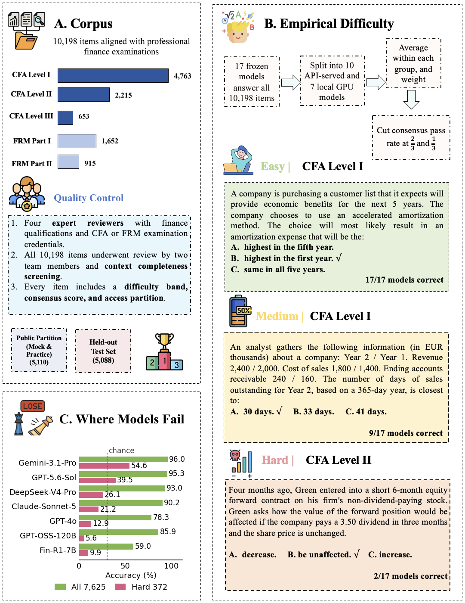

# FinExam-10K: When Retrieval Helps Financial Reasoning?

[Paper](https://arxiv.org/abs/2608.28155) · [Leaderboard](https://yanlin-quinne.github.io/FinExam10k/) · [Public data](data/)

FinExam-10K is a benchmark of 10,198 expert-reannotated English multiple-choice questions aligned with all five
professional finance examination stages: CFA Levels I, II, and III and FRM Parts I and II. This repository releases
the **5,110-item public partition** (mock and practice material) together with a small Python package for loading
the items, building the paper's prompt, running a model, and scoring its answers. The other 5,088 items are held out
for the maintained leaderboard and are not released.



## Public partition

| | Items | Context-complete | Easy | Medium | Hard |
|---|---:|---:|---:|---:|---:|
| CFA Level I | 3,109 | 2,595 | 2,235 | 544 | 330 |
| CFA Level II | 1,030 | 113 | 328 | 310 | 392 |
| CFA Level III | 179 | 22 | 68 | 44 | 67 |
| FRM Part I | 516 | 457 | 366 | 115 | 35 |
| FRM Part II | 276 | 219 | 167 | 74 | 35 |
| **All** | **5,110** | **3,406** | **3,164** | **1,087** | **859** |

Every record has a question, three or four options, a gold answer, the gold option text, and a reference rationale.
Two further fields come from the paper:

- `difficulty` is the frozen empirical band from a fixed panel of 17 models (Easy, Medium, or Hard), with the
  group-balanced pass rate in `consensus_pass_rate`.
- `context_complete` marks whether the standalone record keeps all answer-necessary evidence. Professional
  examinations often place several questions under one shared vignette, table, or exhibit, and flattening such
  item sets can detach that evidence. For the 1,704 incomplete records, `answerability_defect` and
  `missing_referent` say what is missing. The paper's primary results use the context-complete items only.

The same records are provided as [JSONL](data/finexam10k_public_5110.jsonl), [JSON](data/finexam10k_public_5110.json),
[CSV](data/finexam10k_public_5110.csv), and [XLSX](data/finexam10k_public_5110.xlsx) (with the data dictionary and count summaries as extra sheets). The
[data dictionary](data/data_dictionary.csv) defines every field, and [data/summary](data/summary) holds the count
tables above. Two FRM Part II items (`47ee1b7b9094bd33`, `e7960df81ccc2ab9`) were released with options B to D
only and are scored on those three options.

## Quick start

The package uses only the Python standard library (Python 3.10 or later).

```bash
git clone https://github.com/YanLin-Quinne/FinExam10k.git
cd FinExam10k
python -m pip install -e .
```

```python
from finexam10k import build_prompt, load_items, parse_answer, score

items = load_items(context_complete=True)        # 3,406 context-complete public items
print(build_prompt(items[0]))                     # the Direct prompt used for the leaderboard
predictions = {item["id"]: parse_answer(my_model(build_prompt(item))) for item in items}
print(score(items, predictions))                  # accuracy overall, by stage, band, and context
```

`load_items` also filters by `stage` (for example `"CFA Level II"`) and `difficulty` (`"easy"`, `"medium"`, `"hard"`).

## Run and score a model

`finexam10k.run_openai` sends each item to any OpenAI-compatible chat completions endpoint and writes one JSON line
per item. The key is read from an environment variable and is never written to the output.

```bash
export OPENAI_API_KEY=...
python -m finexam10k.run_openai --model gpt-4o --output runs/gpt-4o.jsonl --track context-complete
python -m finexam10k.evaluate runs/gpt-4o.jsonl --track context-complete
```

Use `--base-url` for other providers or a local vLLM server, `--limit 20` for a quick check, `--json-mode` to request
JSON output, and `--no-sampling-params` for reasoning endpoints that reject `temperature`. A rerun skips items that
are already in the output file.

`finexam10k.evaluate` accepts any JSONL file whose lines contain an `id` and either a `prediction` letter or the raw
model `output`. Scoring follows the paper. Every item stays in the denominator, so missing, unparseable,
length-truncated, or out-of-range answers count as incorrect.

## Results

On the 7,625-item Context-Complete Reasoning Track of the full benchmark, the frozen 17-model panel ranges from
56.49% to 95.96%, while the best score on its 372 Hard items is 54.57% and only two models are significantly above
the 30.44% chance rate. Under cyclic option rotation, overall accuracy of 15 rerun models moves by at most 0.49 points,
while the Hard-item answer flip rate, averaged over items, is at least 13.45% for every rerun model. Function-RAG and
FunctionGraph-RAG rescue hundreds of errors but also overturn many correct answers, producing little or negative net
gain. A gate trained on the public items invokes FunctionGraph-RAG for 4.3% of the 4,219 context-complete held-out
questions and raises accuracy from 78.34% to 78.88%.

The [leaderboard](https://yanlin-quinne.github.io/FinExam10k/) lists every model on the Context-Complete, Hard, and
Full Coverage views with stage-level scores. To compare a new model on the released items,
[data/summary/panel_public_scores.csv](data/summary/panel_public_scores.csv) gives the same panel's accuracy on the
5,110 public items, the 3,406 public context-complete items, and their 138 Hard items, which are the subsets that
`finexam10k.evaluate` scores.

## Repository layout

```text
data/          public partition in JSONL, JSON, CSV, and XLSX, data dictionary, count summaries
finexam10k/    loading, prompt, answer parsing, scoring, evaluation and model-running commands
docs/          leaderboard site published with GitHub Pages
scripts/       build script for the leaderboard site
tests/         unit tests (python -m unittest discover -s tests -t .)
```

## Intended use and license

FinExam-10K is built from CFA-aligned and FRM-aligned preparatory materials available for academic research.
Official CFA Institute and GARP examination content is excluded, and CFA Institute and GARP do not endorse this work.
The data supports research on financial reasoning, evaluation, retrieval, verification, and tool use. It is not
financial advice, a substitute for certification, or evidence that a model is safe for autonomous financial
decisions. The data is released for non-commercial research use and the code under the MIT License, as set out in
[LICENSE.md](LICENSE.md).

## Citation

```bibtex
@misc{lin2026finexam10k,
  title         = {{FinExam-10K}: When Retrieval Helps Financial Reasoning?},
  author        = {Lin, Yan and Sun, Jingyu and Guo, Zhongliang and Li, Qing and Xie, Zhuohan and Wang, Yuxia},
  year          = {2026},
  eprint        = {2608.28155},
  archivePrefix = {arXiv},
  primaryClass  = {cs.CL},
  url           = {https://arxiv.org/abs/2608.28155}
}
```
